# 🪺 TaskNest — Kanban Task Management App

**ApexLark Full Stack Development Internship · Day 07 · JavaScript Mini Project**

TaskNest is a task manager with a **neo-brutalist** look and a **Kanban board**. Tasks sit in three columns (Pending → In Progress → Completed) and move between them by drag-and-drop, arrow buttons or a checkbox. It is built with plain **HTML5, CSS3 and ES6+ JavaScript** (no frameworks), and every change is saved to the browser's **Local Storage**.

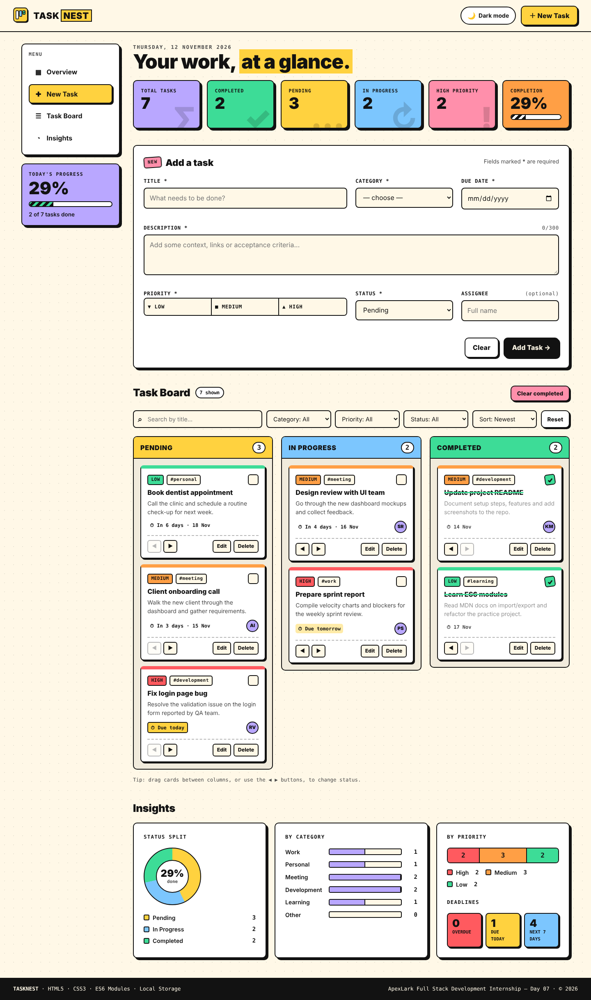

---

## ✨ Features

### Layout
| Section | What it contains |
|---|---|
| **Header** | Logo, Dark/Light mode switch, quick "＋ New Task" button |
| **Navigation bar** | Sidebar menu on desktop that highlights the section in view; becomes a scrollable strip on tablets and phones |
| **Dashboard** | Six colour tiles (Total, Completed, Pending, In Progress, High Priority, Completion %) and a "Today's progress" card |
| **Task form** | Title, Description, Category, Priority, Due Date, Status, Assignee (optional) |
| **Task list** | Kanban board with search, filter and sort controls |
| **Statistics** | Status donut chart, category bar chart, priority stacked bar, deadline counters |
| **Footer** | Tech stack and internship credits |

### Task operations
- **Create** a task with full client-side validation
- **Edit**: the form switches to *Edit mode*, is pre-filled, and can be cancelled
- **Delete** through a native `<dialog>` confirmation (Keep it / Delete / Esc / click outside)
- **Mark complete** with the checkbox on each card (untick to move it back to Pending)
- **Change status** by dragging a card to another column, or with the ◀ ▶ buttons (these work on touch screens too)
- **Clear completed** removes all finished tasks after confirmation

### Search, filter, sort
- Live search by title while you type
- Filter by **category**, **priority** and **status** (filters can be combined)
- Sort by **newest**, **due date** (soonest/latest) or **priority** (high→low / low→high)
- **Reset** returns everything to the default view
- Separate empty states for "Your nest is empty" and "No tasks match"

### Dashboard analytics (recalculated after every change)
Total · Completed · Pending · In Progress · High Priority · **Completion %**, plus Overdue, Due today and Due in the next 7 days.

### Validation rules
| Field | Rule |
|---|---|
| Title | required · 3–60 characters |
| Description | required · 10–300 characters (live counter) |
| Category | required · one of Work, Personal, Meeting, Development, Learning, Other |
| Priority | required · Low / Medium / High |
| Due date | required · real date · not in the past (an existing date may be kept while editing) |
| Status | required · Pending / In Progress / Completed |
| Assignee | optional · if given, 2–40 letters, spaces, `.` `'` `-` |

Errors show under each field, the field shakes, the first invalid field gets focus, and a toast says how many fields need fixing.

### UI / UX extras
- 🌗 Dark / Light theme, saved in Local Storage, defaults to the OS preference
- 🔔 Colour-coded toast notifications (click to dismiss)
- 🎞️ Animations: blocks rise in, cards drop in, deleted cards shrink away, the dialog pops in, toasts slide down, invalid fields shake
- 📱 Responsive at 1280 / 1024 / 820 / 560 / 380 px, with no sideways scrolling
- ♿ Skip link, ARIA labels, keyboard-friendly controls, visible focus outlines, `prefers-reduced-motion` support
- 🔒 All user text is HTML-escaped before rendering (XSS-safe)
- 🔄 Open tabs stay in sync through the `storage` event

---

## 🧱 Project Structure

```
Day-07-Task-Management/
│
├── index.html                 # header, sidebar nav, dashboard, form, board, insights, footer, dialog
├── css/
│   ├── style.css              # design tokens, components, light/dark themes, keyframes
│   └── responsive.css         # breakpoints 1280 / 1024 / 820 / 560 / 380
├── js/
│   ├── app.js                 # TaskNest class: state, CRUD, filter/sort, stats, drag & drop, events
│   ├── storage.js             # Storage object: safe Local Storage read/write
│   ├── ui.js                  # rendering: board, stats, charts, toasts, dialog, form, theme
│   └── validation.js          # rule-based validation schema + option lists
├── assets/
│   ├── images/
│   │   ├── nest-empty.svg
│   │   └── screenshots/       # 12 screenshots of the app
│   └── icons/
│       └── nest.svg
└── README.md
```

### How the modules fit together

```
                 ┌──────────────────────────┐
                 │   app.js  (TaskNest)     │
                 │   state · logic · events │
                 └───────┬────────┬─────────┘
          import         │        │        import
      ┌──────────────────┘        └──────────────────┐
      ▼                     ▼                         ▼
 storage.js          validation.js                 ui.js
 Local Storage       rules + OPTIONS        DOM rendering only
```

- **storage.js** is the only module that touches `localStorage`. Every call is wrapped in `try/catch`.
- **validation.js** describes each field as a list of small rule functions (`required`, `minLen`, `oneOf`, …) and runs them with `reduce`.
- **ui.js** turns data into DOM and contains no business logic.
- **app.js** keeps the tasks in a private class field (`#tasks`). Every change goes through `#commit()`, which saves to Local Storage and re-renders the page.

### ES6+ features used
`import`/`export` modules · `class` with private fields (`#tasks`, `#commit`) and getters · arrow functions · object/array destructuring · spread `...` · template literals · default parameters · `map` / `filter` / `find` / `sort` / `reduce` / `some` · `Object.entries` / `Object.fromEntries` · Promises + `async/await` (confirm dialog) · optional chaining `?.` · nullish coalescing `??` · `Object.freeze`.

---

## 🚀 Running the project

> The app uses ES6 modules (`<script type="module">`). Browsers refuse to load modules from `file://`, so **open the project through a local server**. Double-clicking `index.html` will not work.

- **VS Code:** install *Live Server* → right-click `index.html` → **Open with Live Server**
- **Python:** `python -m http.server 5500` → open `http://localhost:5500`
- **Node:** `npx serve .`
- **GitHub Pages:** repo *Settings → Pages → Deploy from branch → main / (root)*

---

## 💾 Local Storage

| Key | Value |
|---|---|
| `tasknest:tasks` | JSON array of task objects |
| `tasknest:theme` | `"light"` or `"dark"` |

```json
{
  "id": "b7e3c1d2-4f5a-4b6c-8d9e-0a1b2c3d4e5f",
  "title": "Prepare sprint report",
  "description": "Compile velocity charts and blockers for the weekly sprint review.",
  "category": "Work",
  "priority": "High",
  "dueDate": "2026-11-13",
  "status": "In Progress",
  "assignee": "Priya Sharma",
  "createdAt": 1762934400000,
  "updatedAt": 1762934400000
}
```

---

## 📸 Screenshots

| | |
|---|---|
| **Dashboard (light)**  | **Dashboard (dark)** 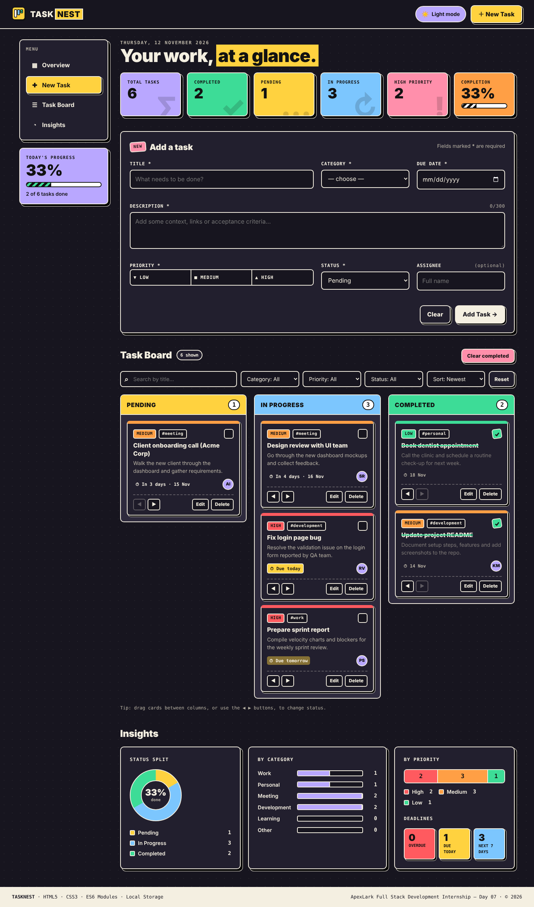 |
| **Empty state** 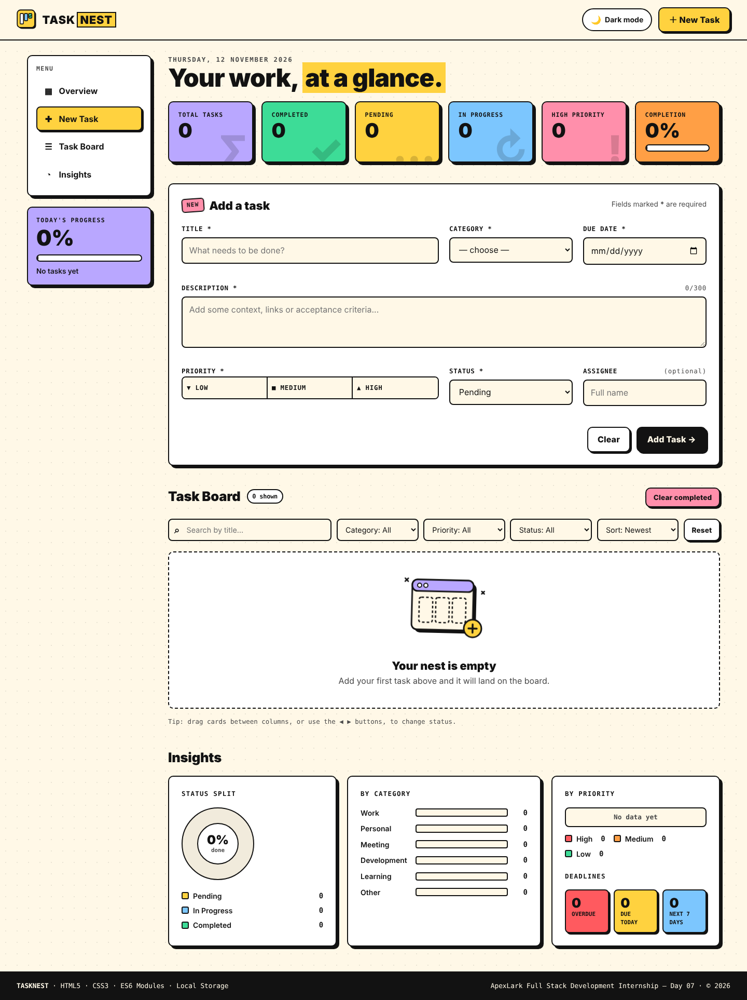 | **Form validation** 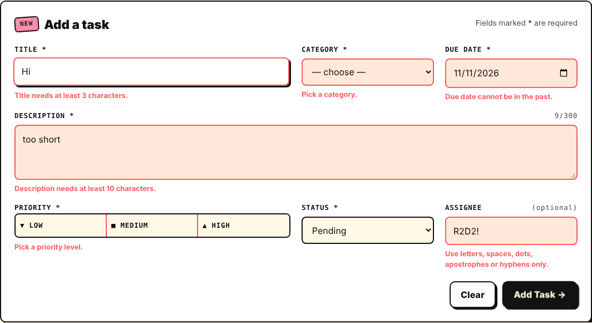 |
| **Search + filter** 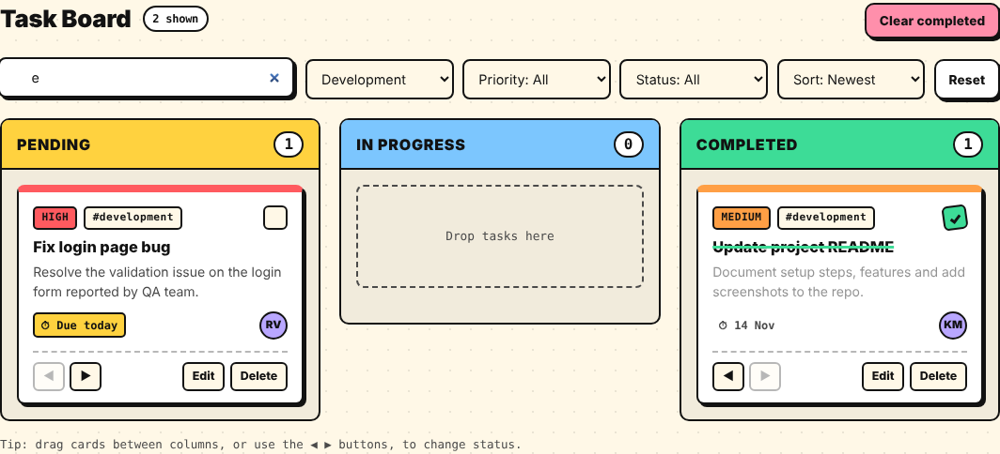 | **Edit mode** 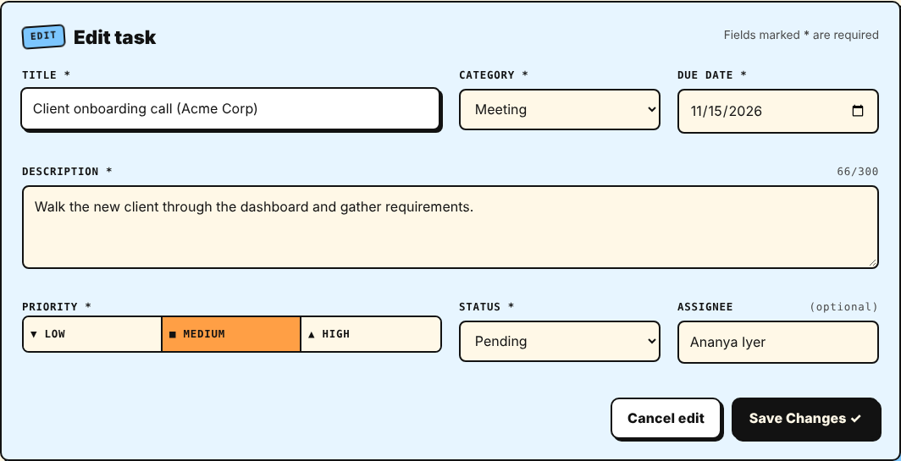 |
| **Kanban board + toast** 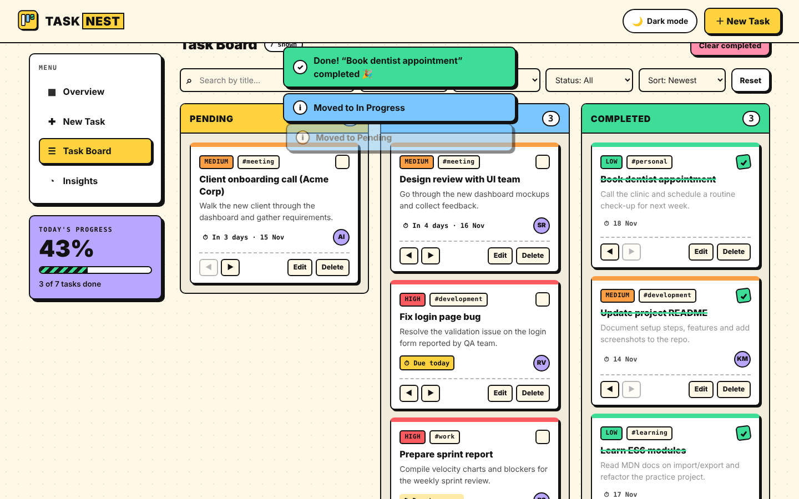 | **Delete confirmation** 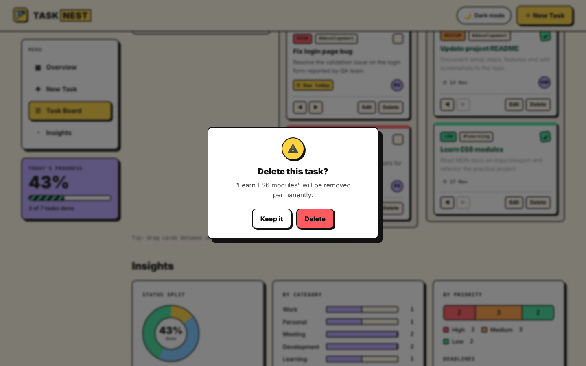 |
| **Insights** 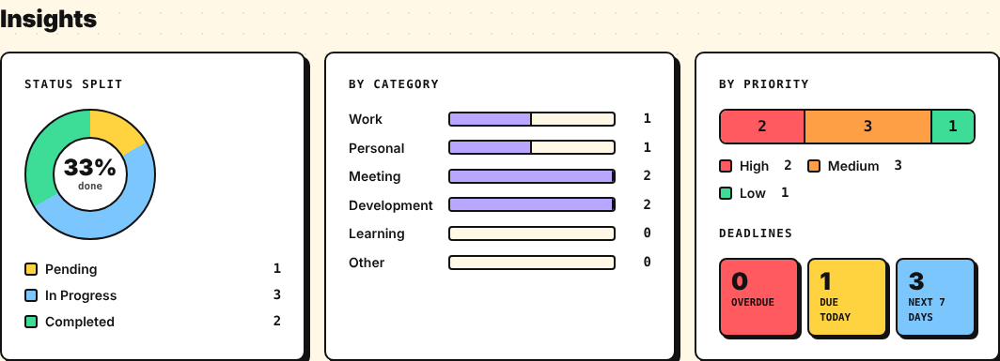 | **Mobile dashboard** 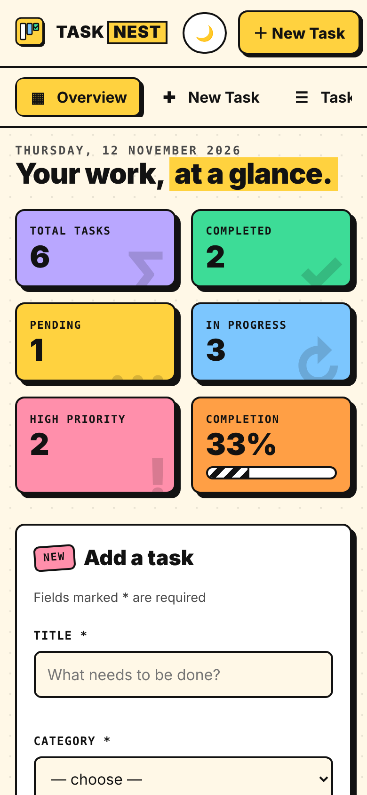 |
| **Mobile board** 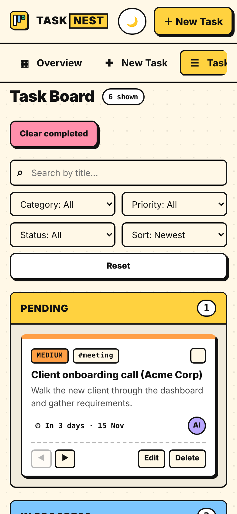 | **Mobile form** 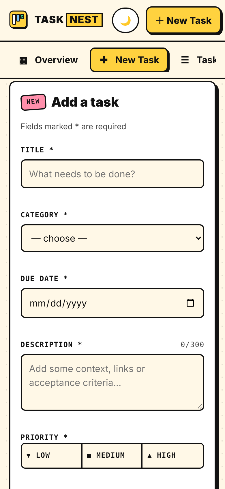 |

---

## ✅ Manual test checklist

- [x] Empty submit → errors on every required field
- [x] Short title/description, past date, invalid assignee → rejected with messages
- [x] Add tasks → cards appear in the correct column, all counters update
- [x] Reload → tasks and theme are restored
- [x] Edit → form pre-fills, saves, and returns to "Add" mode
- [x] ◀ ▶ buttons and drag-and-drop move cards between columns
- [x] Checkbox moves a task to Completed and back to Pending
- [x] Delete → "Keep it" and Esc cancel; "Delete" removes the task from the board and from storage
- [x] Search, each filter, combined filters, and all five sort options
- [x] No horizontal scrolling at 390 px and 820 px widths
- [x] No console errors

---

## 🎯 Learning outcomes
- Built a complete front-end application with vanilla JavaScript
- Did client-side CRUD with persistent state in Local Storage
- Structured the code into single-purpose ES6 modules
- Built an event-driven, responsive and accessible UI with theming, drag-and-drop and animations

---

## 👤 Author

**Your Name** — Full Stack Development Intern, ApexLark
GitHub: [@your-username](https://github.com/your-username)
